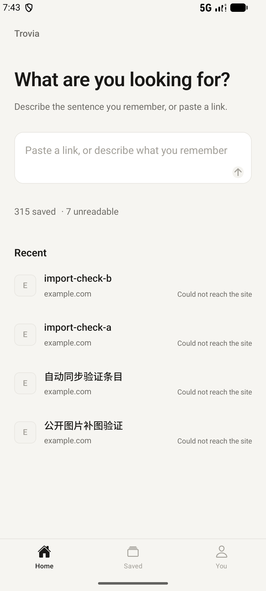
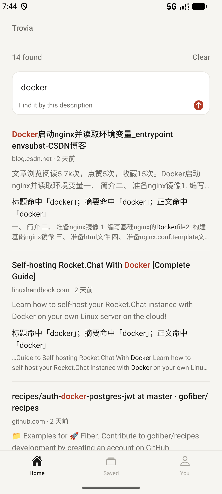
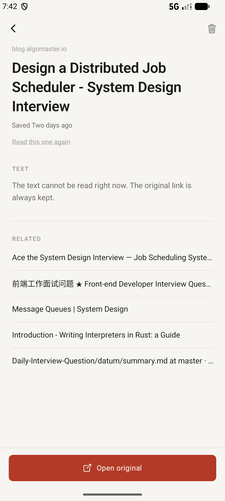

# Trovia

[](https://github.com/wst7/trovia/releases/latest)
[](https://github.com/wst7/trovia/actions/workflows/android.yml)


**English** · [中文](README.zh-CN.md)

**You don't need to remember what you saved — only what you were looking for.**

Hand it a link; it reads the page, keeps it on your own phone, and months later a vague description is enough to get it back.

[Download for Android](https://github.com/wst7/trovia/releases/latest) · [See what it looks like](https://wst7.github.io/trovia/?lang=en)

<p align="center">
  
  
  
</p>

## What it does

- **Save** — paste a link, share from another app, or let it pick up a link on the clipboard. Browser bookmarks, CSV files and plain lists of links can move in at once.
- **Read** — fetches the article text, keeps its images, reads the words inside those images, writes a summary and keywords.
- **Find** — search by a full sentence, a keyword or a time range: "what I saved yesterday", "published in 2022". Every result says why it matched.
- **On device** — no account, nothing uploaded. Saved text and images stay readable offline.
- **Take it with you** — export everything at any time as one `.zip`: a full backup that restores field for field, plus a Markdown copy for people. It is not locked in here.
- **Stay current** — the app checks GitHub for a newer build and installs it in place. Text and logic fixes arrive as hot updates; only native changes need a new APK.
- **Sync** — point it at your own WebDAV (Nutstore, Synology, Nextcloud) and content moves between your phone and your cloud. If two devices both edited an item, the other version is kept as a conflict copy rather than silently overwritten.

## Model support (optional)

Connect any OpenAI-compatible service (OpenAI, OpenRouter, SiliconFlow, Ollama, LM Studio…) and summaries are written by it; with one connected, a search sentence is also sent to it to read your intent. Without one, summaries are extracted offline — nothing is missing. The key only goes into the system keychain.

## Install

**Android** — download `trovia-*-arm64.apk` from [Releases](https://github.com/wst7/trovia/releases/latest). It is signed with a debug key: fine for installing yourself, not for publishing.

**iPhone** — there is no build to download; it needs Xcode or EAS.

## Where it stops

WeChat articles, Juejin, SSPAI, CSDN and similar sites are read in full. Zhihu, Medium, Douban and 36Kr sit behind a sign-in or a bot check, so only the link and title are kept. For video, the title and description are saved; no subtitles.

## Build from source

Requirements: Node 22+, JDK 17, and the Android SDK (only for building the APK).

```bash
npm install

# run on a connected device / emulator
npm run dev:mobile

# release APK (JS bundled in, signed with the debug key)
cd apps/mobile && npx expo prebuild --platform android --no-install
cd android && ./gradlew assembleRelease -x lint -x test
```

Tests and type checks:

```bash
npm test -w @trovia/mobile      # query parsing, composer hints, db migration, i18n
npm test -w @trovia/sync        # sync engine, WebDAV adapter, large-cloud behaviour
cd apps/mobile && npx tsc --noEmit
```

Before a release, `npm run smoke` fetches a handful of real sites (WeChat, SSPAI, Juejin, CSDN, GitHub, Martin Fowler) through the same parser the app uses and fails if any of them stops being readable. The tag build runs it as a gate, so a site that starts blocking us cannot ship quietly.

Hot updates are published on every tag. `runtimeVersion` in `apps/mobile/app.config.ts` is a hand-bumped constant (`native-1`): raise it only when native code, permissions or the package name change, and ship a matching APK with it.

Product scope: [`docs/PRODUCT.md`](docs/PRODUCT.md). API and database conventions: [`docs/ENGINEERING.md`](docs/ENGINEERING.md).
