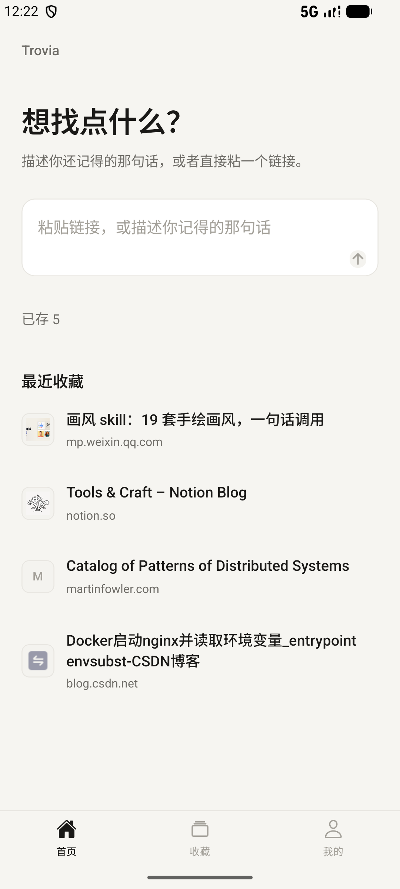
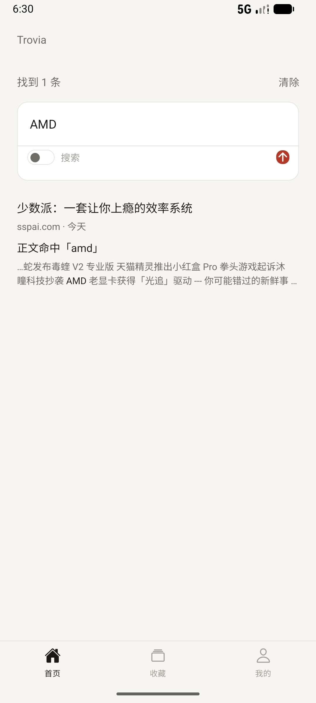
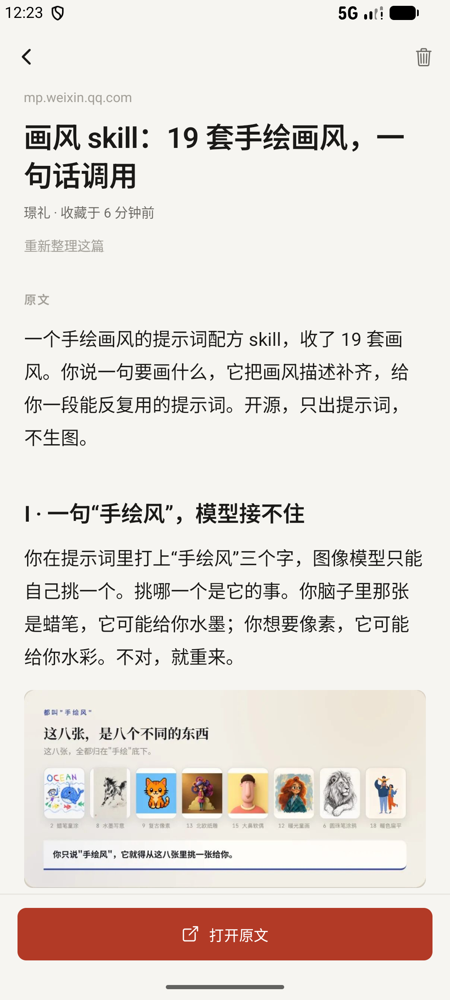

# Trovia

[](https://github.com/wst7/trovia/releases/latest)
[](https://github.com/wst7/trovia/actions/workflows/android.yml)
[](LICENSE)

**中文** · [English](README.md)

存下一个链接。几个月后，你只记得大概，也能把它找回来。

[下载 Android 版](https://github.com/wst7/trovia/releases/latest) · [看看它长什么样](https://wst7.github.io/trovia/)

<p align="center">
  
  
  
</p>

## 能做什么

- **存**：粘贴、系统分享、剪贴板里的链接都能进；书签、CSV、链接清单一次导入。
- **整**：抓正文、存图、读图上的字、写摘要和关键词。
- **找**：一句话、一个词、一段时间都能搜，结果标出为什么命中。
- **同步**：填你自己的 WebDAV；两台设备改过同一条，留一份冲突副本，不悄悄覆盖。
- **带走**：一个 `.zip`，能逐字段还原的备份，外加一份 Markdown。

正文、图片和索引都在这台手机上。可选的 OpenAI 兼容模型负责写摘要、读搜索意图；不配就用离线抽取。

## 安装

到 [Releases](https://github.com/wst7/trovia/releases/latest) 下载 `trovia-*-arm64.apk`。调试密钥签名，自己装没问题，上架不行。iPhone 需要 Xcode 或 EAS 自建。

应用内会检查 GitHub 上的新版本并就地安装；只改 JS 的更新走热更新，不用下载。

## 边界

微信公众号、掘金、少数派、CSDN、V2EX、GitHub、维基百科能读全文；知乎、Medium、豆瓣、36 氪有登录墙或人机验证，只存链接和标题。视频只存标题与简介，不做字幕。

## 构建

```bash
npm install && npm run dev:mobile

cd apps/mobile && npx expo prebuild --platform android --no-install
cd android && ./gradlew assembleRelease -x lint -x test
```

`npm test -w @trovia/mobile` 和 `npm test -w @trovia/sync` 覆盖查询解析、库迁移、同步引擎与 WebDAV 适配。打 tag 前跑 `npm run smoke -w @trovia/mobile`，用同一份抓取代码过一遍上面的站点。

产品边界见 [`docs/PRODUCT.md`](docs/PRODUCT.md)，接口约定见 [`docs/ENGINEERING.md`](docs/ENGINEERING.md)，每个版本改了什么见 [`docs/CHANGELOG.md`](docs/CHANGELOG.md)。

## 许可证

AGPL-3.0，见 [LICENSE](LICENSE)。随便改、随便跑；对外分发或架成在线服务，你的改动也要开源。Trovia 这个名字和图标不在授权范围内。
